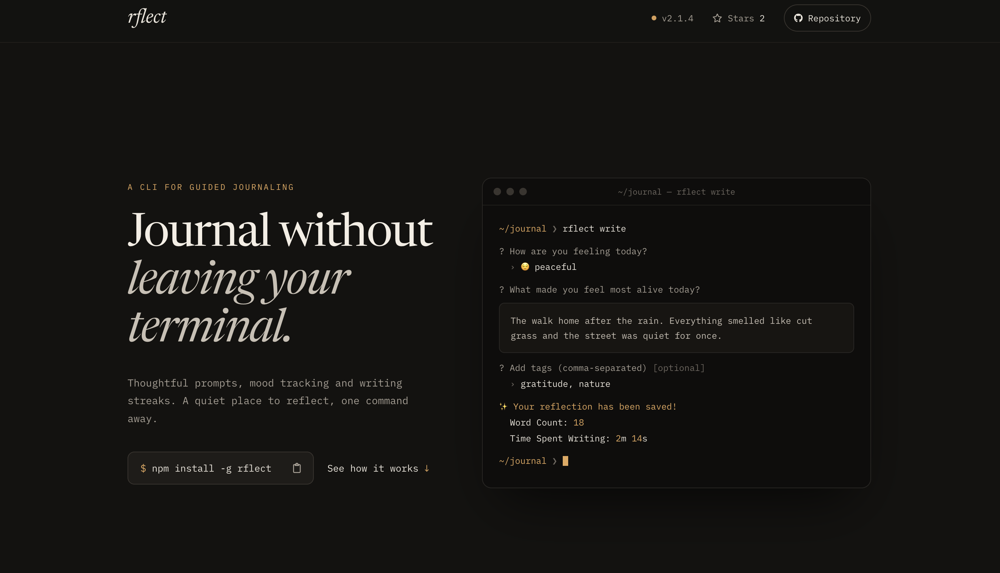

# rflect

The landing page for rflect, a CLI for guided journaling. It walks through each command as a terminal session you scroll through.

**[Live site](https://rflect.aniqa.dev)** · [CLI repository](https://github.com/aniqatc/rflect-cli) · [npm package](https://www.npmjs.com/package/rflect)

<a href="https://rflect.aniqa.dev"></a>

<!-- TODO: this screenshot is from January 2025, before the October 2026 redesign, and shows an IP address in the terminal title bar. Replace it with a screenshot of the current page. -->

## Tech

- React and Vite
- Sass, with partials per section and shared variables
- Framer Motion for scroll-triggered animations
- date-fns for the dates in the terminal demos
- Font Awesome icons
- GitHub and npm APIs for the live star count and version

## Features

- Eight scroll-snapped windows, each pairing a command with a terminal that plays its output: install, setup, writing, prompts, the mood calendar, stats, settings and what's coming next
- A progress rail shows which window you're on and jumps to any of them
- One-click copy for every command, starting with `npm install -g rflect`
- Live GitHub star count and current npm version in the header

## Design

- Terminal output matches what rflect-cli prints, so the page shows the real tool rather than a mockup
- Demos use today's date, so the mood calendar always shows the current month
- On smaller screens each window stacks its terminal underneath the description

## Accessibility

- The progress rail is a labeled list that marks the current step with `aria-current`
- Screen readers hear "Copied!" when a command is copied
- Decorative icons are hidden from screen readers
- Respects reduced motion through Framer Motion's `MotionConfig`

## Project structure

- `src/components/`: header (title and status bar), hero, features (window and progress rail), terminal, footer and the reusable copy button
- `src/data/features.js`: each window's title, description, command and terminal output
- `src/styles/`: one Sass partial per section, plus variables and breakpoints

## Key concepts

- **Data-driven sections.** Every window renders from `features.js`, so adding a command means adding one object.
- **Scroll-driven animation.** CSS scroll snapping sets the pace and Framer Motion's `whileInView` reveals each terminal as it arrives.
- **Live data from public APIs.** The star count and version come straight from GitHub and npm, so they never go stale.

## Setup

Requires Node 18+. No API keys needed.

```bash
git clone https://github.com/aniqatc/rflect-landing.git
cd rflect-landing
npm install
npm start
```

## Scripts

| Command | What it does |
| --- | --- |
| `npm start` | Dev server |
| `npm run build` | Production build |
| `npm run preview` | Preview the build |
| `npm run lint` | ESLint |
| `npm run format` | Prettier |

## Changelog

### October 2026

- Redesigned around scroll-snapped feature windows with a progress rail
- Terminal demos rewritten to match the CLI's real output

### January 2025

- Initial release: sticky header and terminal, scroll-triggered demos, copy buttons and live star count and version
